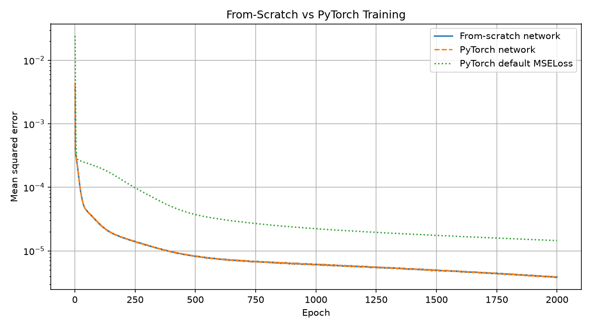

# PyTorch Comparison

## 1. Aim

The aim of this comparison was to evaluate our neural network developed from scratch using NumPy against an equivalent network implemented using PyTorch.

Both networks were trained to predict the spider's 24 joint angles from its position in the walking cycle. The comparison was used to check whether our backpropagation implementation behaved correctly and to examine differences in accuracy, training time and gait fitness.

## 2. Experimental Setup

Both implementations used the same neural network architecture:

- Input layer: 2 neurons
- Hidden layer: 16 neurons
- Output layer: 24 neurons
- Activation function: sigmoid

The training dataset contained 300 examples generated from the genetic algorithm's best gait. Each example had two inputs representing the sine and cosine of the walking phase, and 24 target joint angles scaled between 0 and 1.

For the first experiment, the NumPy and PyTorch networks used identical starting weights and biases, 64-bit floating-point values, the same shuffled training order and stochastic gradient descent with a learning rate of 2.0.

Both networks were trained for 2,000 epochs using one example per weight update.

To ensure equivalent gradients, the PyTorch implementation used half the sum of squared errors as its training loss, matching our implementation.

A second PyTorch experiment used PyTorch's own initial weights and its built-in mean squared error loss, while keeping the network architecture, dataset, learning rate and number of epochs the same.

## 3. Results

| Metric | From-scratch network | PyTorch (matched) | PyTorch (default) |
|---|---|---|---|
| Architecture | 2-16-24, sigmoid | 2-16-24, sigmoid | 2-16-24, sigmoid |
| Training epochs | 2,000 | 2,000 | 2,000 |
| Final mean squared error | 0.0000038019 | 0.0000038019 | 0.0000145100 |
| Training time (seconds) | 14.999 | 195.822 | 159.567 |
| Gait fitness score | 2.166839 | 2.166839 | 2.224903 |
| Largest parameter difference | - | 1.9451 × 10^-13 | Not measured |

## 4. Comparison of Training Accuracy

The from-scratch network and the matched PyTorch network produced almost identical results.

Both achieved a final mean squared error of 0.0000038019, and the maximum difference between their final weights and biases was approximately 1.95 × 10^-13.

Their training error curves also overlapped almost completely throughout the 2,000 epochs.

This provides strong evidence that our manually implemented backpropagation calculations and weight updates are consistent with PyTorch's automatic differentiation under equivalent conditions.

The default PyTorch experiment finished with a higher mean squared error of 0.0000145100.

This was approximately 3.8 times the error of the matched implementations.

The difference is likely related to the changes in loss function and initial weight values, although this experiment does not isolate their individual effects.

## 5. Training Time Comparison

The from-scratch network completed training in 14.999 seconds, compared with 195.822 seconds for the matched PyTorch network.

In this particular experiment, the from-scratch implementation was approximately 13 times faster.

The PyTorch default experiment completed in 159.567 seconds.

A likely explanation is that PyTorch has additional overhead associated with creating and managing tensors, tracking gradients and performing automatic differentiation.

Because the network is small and uses individual training examples rather than larger batches, the overhead may be more noticeable.

These results do not mean that NumPy is generally faster than PyTorch. Performance depends on the network architecture, training method, hardware and implementation.

## 6. Loss Function Differences

Our from-scratch network calculates gradients using half the sum of squared errors:

Loss = 0.5 × sum((prediction - target)^2)

The first PyTorch experiment used the same loss to make the gradient calculations equivalent.

PyTorch's built-in MSELoss() instead calculates the mean squared error by default.

For a single training example with 24 outputs, PyTorch divides the sum of squared errors by 24, whereas our training loss multiplies the sum by 0.5.

Therefore, PyTorch's default MSELoss produces gradients that are 12 times smaller than those from our half-sum loss, when evaluated on the same predictions.

As a result, using the same learning rate of 2.0 does not produce equivalent updates.

The second experiment tested PyTorch's default MSELoss and random initialisation. Its higher final error demonstrates that changing the training configuration affected the results, but it does not establish which change was responsible.

## 7. Gait Fitness Comparison

Both the from-scratch and matched PyTorch networks achieved a gait fitness score of 2.166839.

The default PyTorch network achieved a slightly higher gait fitness score of 2.224903, despite having a higher prediction error.

This shows that prediction error and gait fitness measure different things.

Mean squared error measures how closely the neural network reproduces the genetic algorithm's target joint angles.

Gait fitness evaluates the resulting movement according to criteria such as support, foot lifting, forward movement and penalties for undesirable poses or movement.

Therefore, a network with a slightly higher prediction error may still generate a gait that receives a higher fitness score.

However, this single comparison does not establish that PyTorch's default training configuration consistently produces better gaits.

## 8. Training Error Graph

The graph shows the training mean squared error over 2,000 epochs on a logarithmic scale.

The from-scratch and matched PyTorch curves overlap almost completely, demonstrating very similar learning behaviour.

The default PyTorch curve decreases more slowly and remains above the other two curves.

All three networks show an overall reduction in error during training.

## 9. Limitations

The comparison was performed using one dataset generated from the genetic algorithm's best gait.

The 300 frames contain five repetitions of the walking cycle, so the examples are not fully independent.

The comparison therefore evaluates how accurately the networks reproduce a particular gait rather than their ability to generalise to different walking patterns.

Only one recorded training run was used for each configuration. Repeated experiments would provide stronger evidence about the consistency of the results.

The default PyTorch experiment also changed both the loss function and weight initialisation, meaning their individual effects cannot be separated.

Finally, the training-time comparison depends on the computer and implementation, so it should not be treated as a general benchmark of NumPy against PyTorch.

## 10. Use of AI Tools

ChatGPT was used to help understand the comparison requirements, explain differences between PyTorch and our manually implemented neural network, and assist with the structure of the PyTorch comparison code and report.

The implementations were executed and tested in VS Code. All numerical results in this report were taken from the actual program output.

AI assistance was also used to help interpret the results, including the differences in loss functions, numerical precision and training performance.

## 11. Conclusion

The comparison demonstrated that our manually implemented neural network and the equivalent PyTorch network produced virtually identical results when trained under matching conditions.

The final mean squared errors, gait fitness scores and training curves were almost identical, while the maximum parameter difference was approximately 1.95 × 10^-13.

This provides strong evidence that our from-scratch backpropagation implementation is mathematically consistent with PyTorch's automatic differentiation.

The PyTorch default experiment produced a higher prediction error but a slightly higher gait fitness score, demonstrating that reproducing the target angles more accurately does not necessarily result in a higher gait fitness score.

Overall, the comparison helped validate our implementation and highlighted how the choice of loss function, initial weights and training procedure can influence neural network performance.
