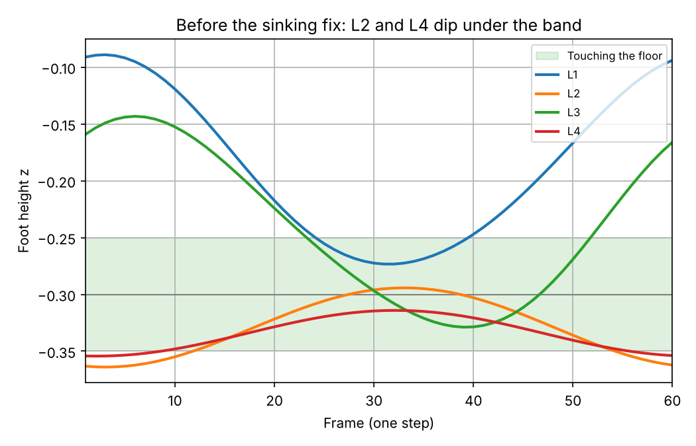
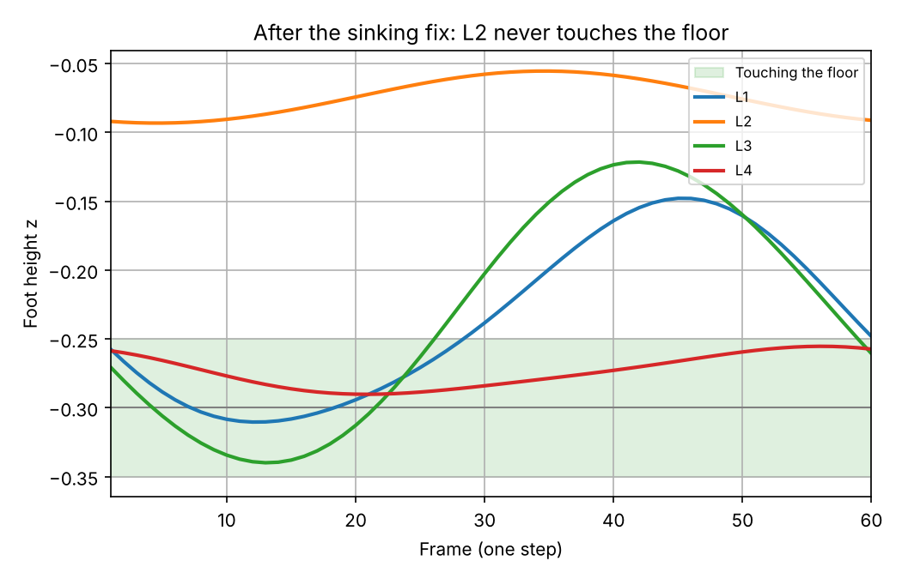
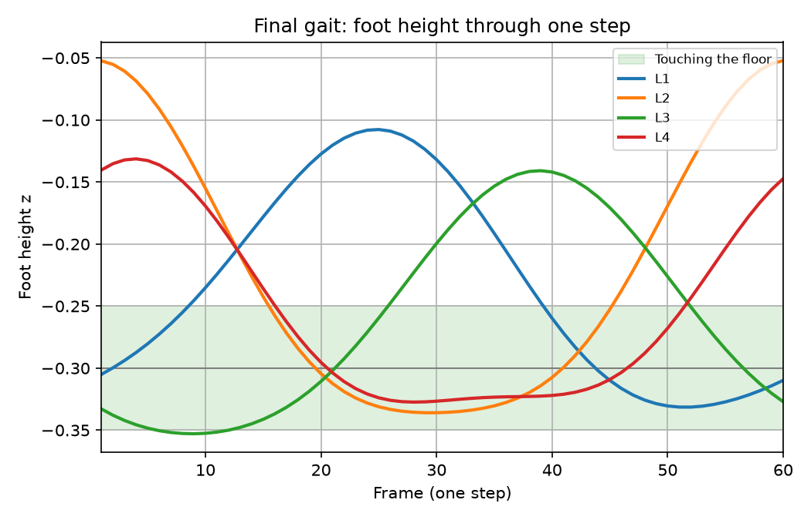

# Visualisation: catching faults the fitness score hid

## Why the score alone was not enough

The fitness graph shows whether the GA is improving, but not *how* it is getting its points. Twice the best fitness rose steadily while the gait was getting its points from a gap in the fitness function rather than from walking. The fitness graph looked healthy both times. The faults only showed up when we looked at what the feet were actually doing.

We used three visuals:

| Visual | Made by | What it shows |
| --- | --- | --- |
| Fitness graph (best and average per generation) | `ga.py`, `save_results.py` | Whether the GA is improving and when it levels off |
| 3D animation of the best gait | `show_best.py`, `gait.animate()` | The whole gait at once: team timing, leg spacing, anything that looks wrong |
| Foot height through one step, with the floor band shaded | `foot_heights.py` | Exactly how low and how high each foot goes, against the floor band (-0.35 to -0.25) |

The animation is good for spotting that something is odd, but the floor is only 0.05 thick, so it is hard to see in 3D whether a foot is just above the band or just below it. The foot height graph answers that, which is why it was added.

## Fault 1: sinking instead of lifting

**What happened.** Run with seed 42 and population 40, before commit `fbc58bd`. At that point a foot only counted as planted inside the band. The GA found that a foot dropped below -0.35 was "not planted", so it could swing forwards under the floor without cancelling the forward reward. The small below-floor penalty did not stop this.

**How it showed up.** In the graph, L2 and L4 never rise above the band: their highest points are -0.294 and -0.314. Instead they dip below it, to -0.364 and -0.354, and that is where they move forwards. Healthy feet (L1, L3) do the opposite: they dip into the band and rise well above it. The right partners R2 and R4 copy L2 and L4, so four of the eight legs were doing this. **[check: say who spotted it first, and whether the animation or the numbers raised it.]**

**The fix.** A foot at or below -0.25 now counts as touching the floor (commit `fbc58bd`), so a sunk foot moving forwards cancels the forward reward. The best score at generation 50 fell from 1.76 to 1.57. That is not a worse gait: the GA lost points it had been getting without walking.

## Fault 2: legs held in the air (hovering)

**What happened.** The same seeded run after the sinking fix, before commit `e239a78`. Lift was scored from each foot's highest point only, so a leg held up the whole time still earned full lift.

**How it showed up.** L2's foot never comes near the floor: its lowest point is -0.093, far above the band, so L2 and R2 hover for the whole step. The other six legs still kept four feet down, so the support reward did not notice. It was confirmed by checking each foot's lowest point (`fitness_design.md`), which is what the bottom of each line in the graph shows.

**The fix.** Lift now only counts for a foot that touches the floor at some point in the step (commit `e239a78`).

The same graph also shows L4 shuffling inside the band without lifting clear of it (highest -0.255). This is the back-leg weakness listed under known limits in `fitness_design.md`. It went away in the final population-80 run.

## The final gait

In the final gait every foot dips into the band and rises well above it. Their highest points range from -0.141 (L3) to -0.052 (L2), at least 0.11 above the top of the band. The lowest any foot goes is -0.353 (L3), only 0.003 below the band and for 6 frames in each 60-frame step, rather than a whole return stroke under the floor. That is the pattern the two faulty runs did not have. The fitness graph, GIF and still poses of this gait are in `results/` (made by `save_results.py`).

## Reproducing the earlier runs

The code that produced the two faulty gaits has since changed, so their best chromosomes are saved in `results/earlier_runs/` and `python foot_heights.py` redraws both graphs. They were made by checking out the commit before each fix and running `run_ga(42)` (population 40, 50 generations). The final scores match the ones in `fitness_design.md`: 1.76 before the sinking fix and 1.57 after it.
