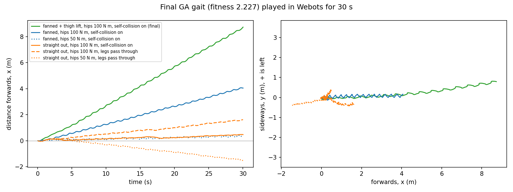
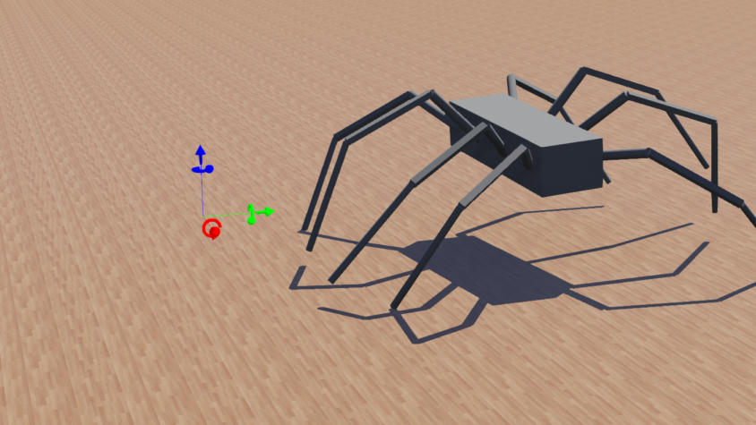

# Playing our gait in Webots

The module provides a Webots world with a physics spider (`SpiderOctopod`). This folder plays our final GA gait on that robot, to see how a gait evolved in our kinematic model (no gravity, no friction, body fixed) behaves under physics.

The Webots spider is built differently from the MATLAB model our GA used: a box body (1.3 × 0.4), legs in two rows pointing sideways, shorter segments (0.5, 0.6, 0.7 against our 1.2, 0.7, 1.0) and a hip that turns about a 45° axis. So this tests our gait's pattern of joint movements on a different body, not an exact copy of our walk.

## Files

| File | What it does |
| --- | --- |
| `export_gait.py` | Saves the final gait as `controllers/gait_player/gait.csv` (300 frames × 24 angles) |
| `controllers/gait_player/gait_player.py` | Webots controller: stands the robot up, converts our angles to the robot's, plays the gait, logs the body's position |
| `controllers/gait_player/gait.csv` | The exported gait, plus each foot's height in our model |
| `controllers/gait_player/webots_log.csv` | Body position every timestep, written by the controller after a run |
| `results/webots_log_*.csv` | The logs from the runs in Results |
| `results/webots_distance.png` | Distance against time and the path of the body for six of the runs |
| `results/webots_walk_fanned.jpg` | Screenshot of a run with the legs fanned (before the thigh lift), hips at 100 N m, self-collision on |
| `results/webots_walk.jpg` | Screenshot of an earlier run with the legs straight out (hips at 100 N m) |
| `results/webots_clipping.png` | Screenshot of two neighbouring legs passing through each other |

Webots is not needed for anything else in this repo.

## Running it

1. Install Webots R2025a and open the module's `Spider_world_demo` world (see the module's Webots instructions). If Python is not on your PATH, set Tools > Preferences > Python command to your `python.exe`, or Webots closes when the controller starts.
2. From the main repo folder: `python webots/export_gait.py`
3. Copy the `controllers/gait_player` folder into `Spider_world_demo/controllers/`.
4. In Webots, in the scene tree on the left, open `SpiderOctopod`, select its `controller` field and choose `gait_player`. Save the world.
5. In `Spider_world_demo/protos/SpiderOctopod.proto`, change `maxTorque 50.0` to `maxTorque 100.0` for the eight `*_hip_joint` motors only. At 50 N m the hips cannot swing (see Results).
6. So the legs can't pass through each other, add `selfCollision TRUE` under `controller "gait_player"` in the `SpiderOctopod` node of `worlds/spider_world_1.wbt`.
7. Press Play. The robot stands for 3 seconds, then walks for 30 seconds. The console prints its position every step and how far it moved at the end.

## How the angles are converted

Our model and the robot measure angles from different starting points, so each angle is converted:

```
webots angle = webots standing angle + SIGN × SCALE × (our angle − our standing angle)
```

Both robots start in their own standing pose, and each joint then moves away from standing by the same amount as in our gait. With `HIP_FAN = True` (the default), the Webots standing pose angles each hip like the matching leg in our model, so the legs fan out round the body instead of all pointing straight out sideways, and `FAN_THIGH_LIFT` raises each thigh so every foot still stands at the same height (see Results). `SWING_LIFT` can lift a foot further while it is in the air in our model; it is off by default. `SIGN` is +1 or −1 for each joint type and side, because some joints turn the opposite way on the Webots robot and the left and right sides are mirrored. `SCALE` can shrink the movements if the robot tips over (default 1.0).

### Checking the signs

`SIGN` started as best guesses. To check them, set `MODE = "test"` in `gait_player.py` and reload the world. The controller then runs six checks on a loop: the hip, thigh and knee of L1, then of R1. Each joint moves from standing in our positive direction and back, and the console says what the foot should do:

- **hip:** left feet swing **backwards** (right feet swing forwards). The foot is lifted first so the floor can't stop the swing.
- **thigh:** the foot **lifts up**
- **knee:** the lower leg **straightens** (the foot lifts and moves outwards)

For each check the console prints the target, the angle the joint reached, the motor's torque and how far the body moved. A foot pushed into the floor instead of lifting shows up as the joint stalling short of its target while the body rises. If a joint moves the wrong way, flip its number in `SIGN`. Set `MODE = "play"` again for the real run.

## Results

Run on 26 November 2026 in Webots R2025a, with the final GA gait (fitness 2.227) at 2 seconds per step. The final setup fans the legs out like our model, levels the feet with a thigh lift, raises the hip motors to 100 N m and turns self-collision on. With that, the spider walked 8.72 m forwards in 30 seconds and drifted 0.79 m to the side. Distances below are the ones the controller prints, measured from where the robot finishes standing up.

### Signs

| Joint | L | R | Notes |
| --- | --- | --- | --- |
| hip | +1 | +1 | first guess was right |
| thigh | +1 | −1 | first guess was right |
| knee | +1 | −1 | both flipped from the first guess |

With the first knee signs, both knees stalled at about 40% of their swing and the body rose, so the foot was pushing into the floor instead of lifting. After flipping, the knees reached their targets and the body dropped slightly. All six signs also match the joint axes in `SpiderOctopod.proto`, worked through by hand from the hip, thigh and knee positions in the file.

### The hip motors are too weak

With the module's robot unchanged, the hips do not move. In the sign test, L1 and L2 were each driven to +1.0 and −1.0 rad with the foot lifted clear of the floor. Every time, the motor sat at its full ±50 N m and the joint moved 0.001 rad. The module's demo controller only moves the thighs and knees, which may be why this hasn't come up before.

Raising the limit to 500 N m let the hips reach 1.0 rad. Holding a lifted leg there took about 44 N m, with peaks of 64 N m while moving. The hip turns about a 45° axis, so it has to lift part of the leg's weight as it swings, and 50 N m is right on the edge of what that needs. The runs below use 100 N m on the hips only, except where the table says 50; thighs and knees stay at 50 N m.

### The legs tangled until they were fanned out

The first runs copied our joint movements onto the Webots legs with every hip standing at 0, so all eight legs pointed straight out sideways in two rows. Our model's legs don't stand like that. They fan out round the body (`BASE_ANGLES` in `spider_model.py`), from 45° for the front legs to 135° for the back ones, and the gait was evolved with that spacing. On the Webots robot the middle hips are only 0.325 m apart, so neighbouring legs passed through each other, and once self-collision was turned on the back legs caught on each other and tangled.

`HIP_FAN` fixes this by standing each Webots hip at its leg's angle in our model: front legs angled forwards, back legs backwards. The Webots hip turns about a tilted axis, so the fan comes out narrower than ours (the front feet point about 67° from forwards instead of 27°), but the gap between the L2 and L3 feet roughly doubles, from 0.325 m to 0.66 m. The hips then hold about ±1.1 rad all the time, which the 50 N m motors can't manage.

### Levelling the feet

Turning a hip about the tilted axis also lowers the foot. With the fan alone, the front and back feet stood 0.175 m lower than the third pair, so the front and back legs held the body up, the front feet pressed into the floor and the third pair hovered above it. `FAN_THIGH_LIFT` raises each thigh just enough to put every foot back at the height it has with the hips at 0: 0.365 rad for the front and back pairs, 0.079 for the second pair and 0.007 for the third. These came from working through the leg positions in `SpiderOctopod.proto`. Levelling the feet more than doubled the distance, from 4.05 m to 8.72 m.

### Distance in 30 seconds

| Legs | Hip motors | Self-collision | Forwards (x) | Sideways (y) | Speed | Body height while walking |
| --- | --- | --- | --- | --- | --- | --- |
| Fanned, feet levelled | 100 N m | on | **+8.724 m** | +0.788 m | 0.291 m/s | 0.39 to 0.44 m |
| Fanned, feet levelled, extra lift in the air (all legs) | 100 N m | on | +6.690 m | +1.834 m | 0.223 m/s | fell to 0.27 m |
| Fanned, feet levelled, extra lift in the air (front pair only) | 100 N m | on | +4.039 m | +0.603 m | 0.135 m/s | 0.31 to 0.36 m |
| Fanned | 100 N m | on | +4.046 m | +0.157 m | 0.135 m/s | 0.62 to 0.68 m |
| Fanned | 50 N m | on | +0.340 m | −0.090 m | 0.011 m/s | 0.44 to 0.51 m |
| Straight out | 100 N m | on | +0.467 m | +0.345 m | 0.016 m/s | 0.33 to 0.41 m |
| Straight out | 100 N m | off | +1.612 m | −0.325 m | 0.054 m/s | 0.31 to 0.42 m |
| Straight out | 50 N m | off | −1.519 m | −0.396 m | −0.051 m/s | 0.30 to 0.36 m |

Positive y is to the robot's left. Each run is 30 seconds of walking after 3 seconds of standing up. The log for the all-legs extra-lift run was lost, so its height comes from the console.



With the legs fanned, the feet levelled and strong enough hips, the gait walks forwards at a steady 0.29 m/s and stays upright for the full 30 seconds, with the body between 0.39 and 0.44 m high. It drifts 0.79 m to the left over 8.72 m, about 9%. That is nearly 19 times further than the same gait with the legs straight out and self-collision on, which shows how much the gait depends on the leg spacing and foot heights it was evolved with.

The weak-hip runs show where the forward motion comes from. With the hips at 50 N m and the legs straight out, the same thigh and knee movements push the robot 1.52 m backwards. With the legs fanned, the weak hips can't even hold the fan and the spider barely moves. So the hip swing, the part of the gait that our fitness function's forward term rewards, is what drives the walk.

Webots gave exactly the same result every time the same setup was rerun (three times for the final setup), so the results are repeatable from the same start.

### A front foot drags

In the final run a front foot still drags along the floor while it swings forwards. Our feet only rise about 0.2 above the contact line, and the shorter Webots legs turn the same knee movement into an even smaller lift. `SWING_LIFT` adds a thigh lift while a foot is in the air in our model, which lifts the feet clear, but the spider then walks less far: 6.69 m with the lift on every leg and 4.04 m with it on the front pair only. So this gait relies on the dragging front feet, most likely because they keep pushing or bracing through the whole step. That has not been tested directly. Fixing it properly would mean letting the gait itself adapt to the Webots body, for example by running the GA with Webots distance as the fitness.



### Earlier runs: legs passing through each other


*From an early run with the legs straight out and self-collision off. Webots ignores contact between a robot's own parts unless `selfCollision` is `TRUE`, so the middle legs overlapped. In the gait, L2 swings back by up to 0.17 rad while L3 swings forward by up to 0.34 rad, and at frame 45 of 300 they move towards each other by 0.44 rad in total, which is enough to cross when the legs stand in rows.*

The straight-out runs also drifted 0.3 to 0.4 m to one side. One possible cause is that the robot's knee limits aren't mirrored: the left knees can only go to 1.0 rad, which cuts off up to 0.18 rad at the top of the swing for L2 to L4. With the legs fanned the drift fell to 0.16 m, so the leg tangling was probably the bigger cause, but it rose again to 0.79 m once the feet were levelled. None of these causes has been tested on its own.

### Why it still doesn't match the model exactly

The kinematic fitness has no gravity, no friction, no balance and a body that never moves, and the Webots robot has a different body, shorter legs and tilted hips. A gait evolved without any of that walks forwards under physics once the legs are spaced and levelled like ours, but the distance can't be compared directly with the fitness score.

### Limits of this test

- One run of each setting, all from the same start position. Webots repeated one run exactly, but other start positions were not tried.
- The hip torque had to be raised and the standing hip and thigh angles changed, so the final run is not on the module's robot exactly as supplied. The 50 N m rows show what happens without the torque change.
- The gait is played at 2 seconds per step so no joint goes over the motors' 2.0 rad/s speed limit. Faster playback was not tried.
