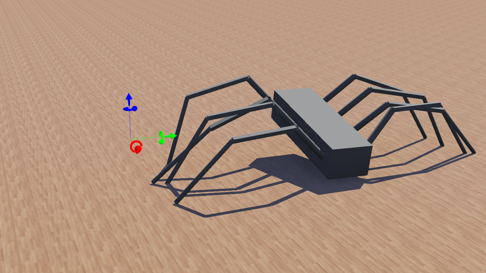
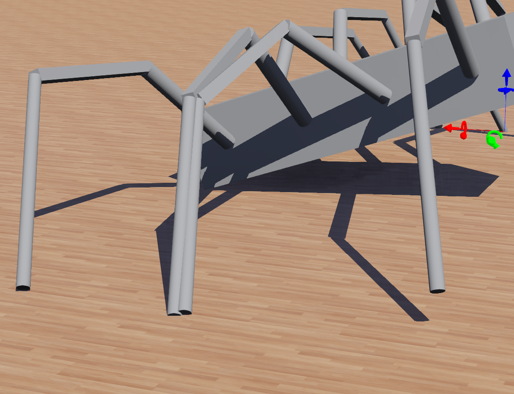

# Playing our gait in Webots

The module provides a Webots world with a physics spider (`SpiderOctopod`). This folder plays our final GA gait on that robot, to see how a gait evolved in our kinematic model (no gravity, no friction, body fixed) behaves under physics.

The Webots spider is built differently from the MATLAB model our GA used: a box body (1.3 × 0.4), legs in two rows pointing sideways, shorter segments (0.5, 0.6, 0.7 against our 1.2, 0.7, 1.0) and a hip that turns about a 45° axis. So this tests our gait's pattern of joint movements on a different body, not an exact copy of our walk.

## Files

| File | What it does |
| --- | --- |
| `export_gait.py` | Saves the final gait as `controllers/gait_player/gait.csv` (300 frames × 24 angles) |
| `controllers/gait_player/gait_player.py` | Webots controller: stands the robot up, converts our angles to the robot's, plays the gait, logs the body's position |
| `controllers/gait_player/gait.csv` | The exported gait |
| `controllers/gait_player/webots_log.csv` | Body position every timestep, written by the controller after a run |
| `results/webots_log_*.csv` | The logs from the three runs in Results |
| `results/webots_distance.png` | Distance against time and the path of the body for all three runs |
| `results/webots_walk.jpg` | Screenshot of the walking run (hips at 100 N m) |
| `results/webots_clipping.png` | Screenshot of two neighbouring legs passing through each other |

Webots is not needed for anything else in this repo.

## Running it

1. Install Webots R2025a and open the module's `Spider_world_demo` world (see the module's Webots instructions). If Python is not on your PATH, set Tools > Preferences > Python command to your `python.exe`, or Webots closes when the controller starts.
2. From the main repo folder: `python webots/export_gait.py`
3. Copy the `controllers/gait_player` folder into `Spider_world_demo/controllers/`.
4. In Webots, in the scene tree on the left, open `SpiderOctopod`, select its `controller` field and choose `gait_player`. Save the world.
5. In `Spider_world_demo/protos/SpiderOctopod.proto`, change `maxTorque 50.0` to `maxTorque 100.0` for the eight `*_hip_joint` motors only. At 50 N m the hips cannot swing (see Results).
6. Optional: to stop the legs passing through each other, add `selfCollision TRUE` under `controller "gait_player"` in the `SpiderOctopod` node of `worlds/spider_world_1.wbt`.
7. Press Play. The robot stands for 3 seconds, then walks for 30 seconds. The console prints its position every step and how far it moved at the end.

## How the angles are converted

Our model and the robot measure angles from different starting points, so each angle is converted:

```
webots angle = webots standing angle + SIGN × SCALE × (our angle − our standing angle)
```

Both robots start in their own standing pose, and each joint then moves away from standing by the same amount as in our gait. `SIGN` is +1 or −1 for each joint type and side, because some joints turn the opposite way on the Webots robot and the left and right sides are mirrored. `SCALE` can shrink the movements if the robot tips over (default 1.0).

### Checking the signs

`SIGN` started as best guesses. To check them, set `MODE = "test"` in `gait_player.py` and reload the world. The controller then runs six checks on a loop: the hip, thigh and knee of L1, then of R1. Each joint moves from standing in our positive direction and back, and the console says what the foot should do:

- **hip:** left feet swing **backwards** (right feet swing forwards). The foot is lifted first so the floor can't stop the swing.
- **thigh:** the foot **lifts up**
- **knee:** the lower leg **straightens** (the foot lifts and moves outwards)

For each check the console prints the target, the angle the joint reached, the motor's torque and how far the body moved. A foot pushed into the floor instead of lifting shows up as the joint stalling short of its target while the body rises. If a joint moves the wrong way, flip its number in `SIGN`. Set `MODE = "play"` again for the real run.

## Results

Run on 26 November 2026 in Webots R2025a, with the final GA gait (fitness 2.227) at 2 seconds per step.

### Signs

| Joint | L | R | Notes |
| --- | --- | --- | --- |
| hip | +1 | +1 | first guess was right |
| thigh | +1 | −1 | first guess was right |
| knee | +1 | −1 | both flipped from the first guess |

With the first knee signs, both knees stalled at about 40% of their swing and the body rose, so the foot was pushing into the floor instead of lifting. After flipping, the knees reached their targets and the body dropped slightly. All six signs also match the joint axes in `SpiderOctopod.proto`, worked through by hand from the hip, thigh and knee positions in the file.

### The hip motors are too weak

With the module's robot unchanged, the hips do not move. In the sign test, L1 and L2 were each driven to +1.0 and −1.0 rad with the foot lifted clear of the floor. Every time, the motor sat at its full ±50 N m and the joint moved 0.001 rad. The module's demo controller only moves the thighs and knees, which may be why this hasn't come up before.

Raising the limit to 500 N m let the hips reach 1.0 rad. Holding a lifted leg there took about 44 N m, with peaks of 64 N m while moving. The hip turns about a 45° axis, so it has to lift part of the leg's weight as it swings, and 50 N m is right on the edge of what that needs. The walking runs below use 100 N m on the hips only; thighs and knees stay at 50 N m.

### Distance in 30 seconds

| Run | Forwards (x) | Sideways (y) | Speed | Body height while walking |
| --- | --- | --- | --- | --- |
| Hips 100 N m, legs pass through each other | +1.620 m | −0.325 m | 0.054 m/s | 0.31 to 0.42 m |
| Hips 100 N m, self-collision on | +0.475 m | +0.346 m | 0.016 m/s | 0.33 to 0.41 m |
| Hips 50 N m (module default, hips stuck) | −1.513 m | −0.396 m | −0.050 m/s | 0.30 to 0.36 m |

Every run starts from standing at a body height of 0.168 m. Positive y is to the robot's left.


With working hips, the gait walks forwards at a steady pace and stays upright for the full 30 seconds. A second run with the same settings gave exactly the same positions at every timestep. With the hips stuck, the same thigh and knee movements push the robot backwards about as fast. So in Webots the forward motion comes from the hip swing, the part of the gait that our fitness function's forward term rewards. The robot also stands about twice as high while walking as in the demo's standing pose.



### Why it doesn't match the model exactly

The two runs where the legs pass through each other both drift to the right, by 0.3 to 0.4 m over 30 seconds. One possible cause is that the robot's knee limits aren't mirrored: the left knees can only go to 1.0 rad, which cuts off up to 0.18 rad at the top of the swing for L2 to L4, and the right knees aren't affected. With self-collision on, the drift goes left instead, so the legs knocking into each other matter at least as much. Neither cause has been tested on its own.

Neighbouring legs also pass through each other at points in the step. The spider's `selfCollision` field is `FALSE`, so Webots ignores contact between the robot's own parts. Our model's legs fan out around the body at different angles, but the Webots legs stand in two straight rows with the middle hips only 0.325 m apart. In the gait, L2 swings back by up to 0.17 rad while L3 swings forward by up to 0.34 rad, and at frame 45 of 300 they are moving towards each other by 0.44 rad in total. To measure what that is worth, the walking run was repeated with `selfCollision TRUE`, so the legs block each other. The spider still walked forwards and stayed upright, but only 0.475 m in 30 seconds, under a third of the distance, and it drifted left instead of right. So the 1.62 m is a best case, and the honest figure for a robot whose legs can't pass through each other is about 0.5 m.



*Captured during the 50 N m run, where the hip motors cannot drive the legs. The legs still meet, most likely because the floor pushes the hips round as the robot moves; the hip angles were not logged, so this is not confirmed.*

The bigger differences come from what the kinematic fitness ignores. It has no gravity, no friction, no balance and a body that never moves, and the Webots robot has a different body and shorter legs. A gait evolved without any of that still walked forwards under physics, but the distance here can't be compared directly with the fitness score.

### Limits of this test

- One run of each setting, all from the same start position. Repeating the walking run gave identical results, so Webots is repeatable here, but other start positions were not tried.
- The hip torque had to be raised, so the walking run is not on the module's robot exactly as supplied.
- The gait is played at 2 seconds per step so no joint goes over the motors' 2.0 rad/s speed limit. Faster playback was not tried.
